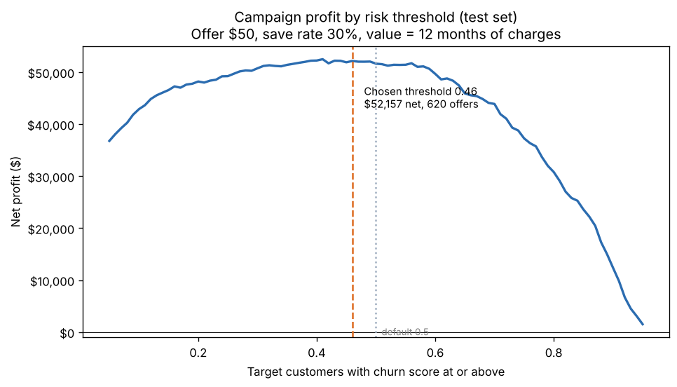
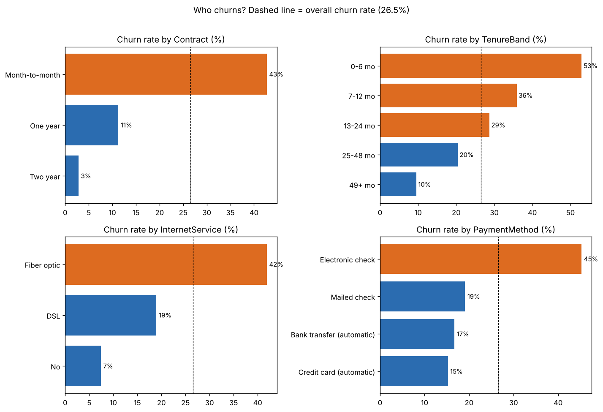
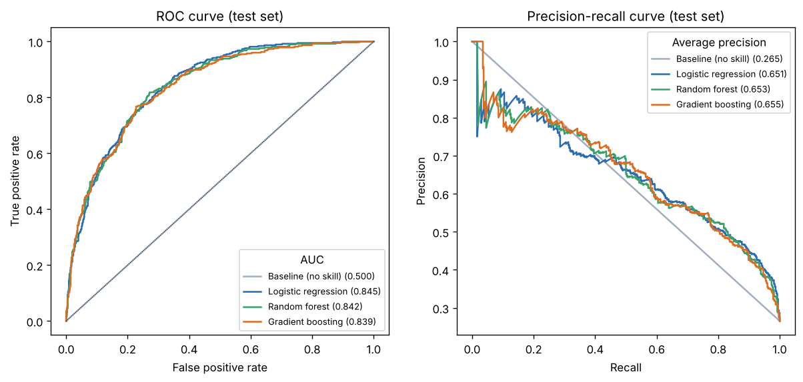
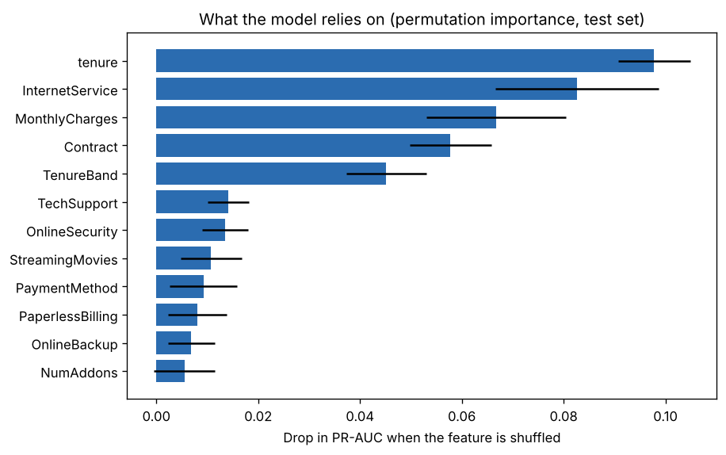
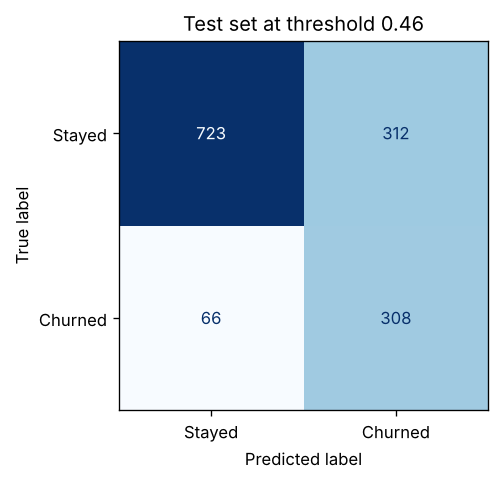

# Churn model: results and business impact

_Generated by `python -m src.train`. Every number below comes from that run._

## Summary

- **Model:** Logistic regression, chosen by PR-AUC in 5-fold cross-validation.
- **Test set performance:** PR-AUC **0.651**, ROC-AUC **0.845** (a no-skill model scores 0.27 PR-AUC and 0.50 ROC-AUC).
- **Recommended action:** offer the retention deal to customers with a churn score of **0.46** or higher. On the held-out test set that means **620 offers**, reaching **308 of 374 churners (82%)**, for an estimated **net gain of $52,157**.

| Strategy (test set, 1,409 customers) | Offers sent | Churners reached | Net profit |
|---|---|---|---|
| Model, profit-optimized threshold (0.46) | 620 | 308 | **$52,157** |
| Model, default threshold (0.5) | 594 | 300 | $51,642 |
| Random customers, same number of offers | 620 | — | $12,289 |
| Offer to everyone | 1,409 | 374 | $27,524 |

**Assumptions** (change them with command-line flags): each offer costs **$50**; it keeps **30%** of customers who would otherwise leave; a saved customer is worth **12 months** of their current monthly charge. The threshold was chosen on cross-validated training predictions, so the test set played no part in any decision.

## Who churns

- Contract: Month-to-month 42.7%, One year 11.3%, Two year 2.8%
- Tenure: 0-6 mo 52.9%, 7-12 mo 35.9%, 13-24 mo 28.7%, 25-48 mo 20.4%, 49+ mo 9.5%
- Internet service: Fiber optic 41.9%, DSL 19.0%, No 7.4%

## Model comparison (5-fold cross-validation, training set)

| model | PR-AUC | PR-AUC sd | ROC-AUC | Recall | Precision | F1 |
|---|---|---|---|---|---|---|
| Logistic regression | 0.663 | 0.014 | 0.848 | 0.795 | 0.521 | 0.629 |
| Gradient boosting | 0.657 | 0.022 | 0.842 | 0.772 | 0.541 | 0.636 |
| Random forest | 0.656 | 0.025 | 0.846 | 0.768 | 0.541 | 0.635 |
| Baseline (no skill) | 0.265 | 0.0 | 0.5 | 0.0 | 0.0 | 0.0 |

PR-AUC is the main metric. Only about a quarter of customers churn, and PR-AUC measures how well the model finds them without flooding the team with false alarms. Accuracy would be misleading: predicting "no one churns" is already about 74% accurate.

## What drives the predictions

Logistic regression odds ratios (above 1 raises churn odds, below 1 lowers them; one-hot categories are relative to the dropped level):

| feature | odds_ratio | effect |
|---|---|---|
| Contract_Two year | 0.4 | lowers churn odds |
| InternetService_DSL | 0.49 | lowers churn odds |
| InternetService_Fiber optic | 2.02 | raises churn odds |
| Contract_Month-to-month | 1.97 | raises churn odds |
| tenure | 0.53 | lowers churn odds |
| MonthlyCharges | 0.54 | lowers churn odds |
| TenureBand_0-6 mo | 1.64 | raises churn odds |
| PaperlessBilling_Yes | 1.41 | raises churn odds |
| TenureBand_13-24 mo | 0.74 | lowers churn odds |
| TenureBand_25-48 mo | 0.74 | lowers churn odds |
| InternetService_No | 0.75 | lowers churn odds |
| OnlineSecurity_No internet service | 0.75 | lowers churn odds |

Read these together, not one at a time. Overlapping features share credit: monthly charges rise with fiber internet and add-on services, so once those are in the model, monthly charges can even show a reversed sign. Permutation importance (chart above) is the better guide to what matters overall.

These are associations, not proof of cause. Month-to-month customers churn more, but that doesn't prove a contract would keep any given customer.

## Errors at the chosen threshold

At threshold 0.46: recall 0.824, precision 0.497. The threshold is below 0.5 because the costs are lopsided: missing a churner loses months of revenue, while a wasted offer costs $50. On the test set it earned $515 more than the default 0.5 cut-off. The threshold was chosen on training data, so small differences on new data are expected; the profit curve is flat near its peak.

## Who to call first (top 10 by revenue at risk, test set)

| customerID | Contract | tenure | MonthlyCharges | churn_score | revenue_at_risk |
|---|---|---|---|---|---|
| 1400-MMYXY | Month-to-month | 3 | 105.9 | 0.955 | 1,213.61 |
| 4587-VVTOX | Month-to-month | 6 | 105.3 | 0.943 | 1,191.57 |
| 5052-PNLOS | Month-to-month | 3 | 105.35 | 0.923 | 1,166.86 |
| 3292-PBZEJ | Month-to-month | 11 | 111.4 | 0.867 | 1,159.01 |
| 6023-YEBUP | Month-to-month | 3 | 100.95 | 0.953 | 1,154.46 |
| 7181-BQYBV | Month-to-month | 1 | 102.45 | 0.928 | 1,140.88 |
| 2027-FECZV | Month-to-month | 12 | 106.7 | 0.879 | 1,125.47 |
| 8884-ADFVN | Month-to-month | 7 | 101.95 | 0.919 | 1,124.3 |
| 9221-OTIVJ | Month-to-month | 14 | 104.85 | 0.876 | 1,102.18 |
| 9057-SIHCH | Month-to-month | 3 | 96.6 | 0.95 | 1,101.24 |

Full list: `reports/top_at_risk_customers.csv`.

## Limitations

- **Single snapshot.** The data doesn't say *when* customers churned, so this ranks risk, not timing.
- **Business assumptions.** Offer cost, save rate and value horizon are estimates; the profit curve shows how sensitive the result is. A real deployment would A/B test the offer to measure the true save rate.
- **Sample dataset.** IBM's Telco data is a teaching sample, so this demonstrates method, not a real company's numbers.
